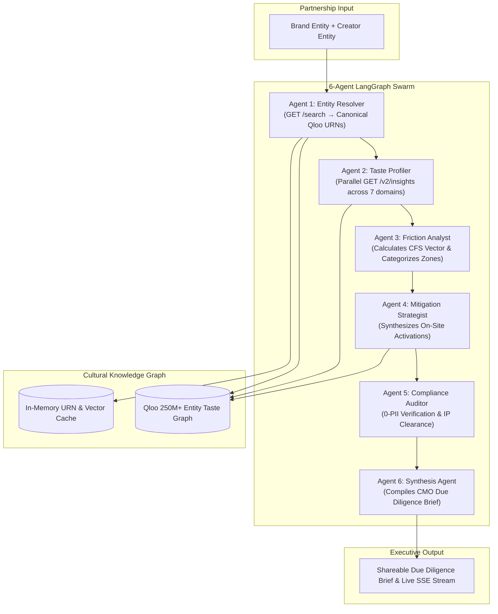

# TasteGuard — Cultural Friction Engine for Brand & Creator Partnerships
### Autonomous Multi-Agent Decision System, Vector Taste Decompositions & Qloo Graph Mitigation Strategies

<div align="center">

[](https://opensource.org/licenses/MIT)
[](https://github.com/langchain-ai/langgraph)
[](https://qloo.com)
[](https://docs.qloo.com)
[](https://nextjs.org)
[](https://www.python.org)

<br />

**An autonomous multi-agent decision system evaluating Cultural Friction Scores (CFS) across brand and creator partnerships using 250M+ node cultural taste graphs.**

[System Architecture](#-system-architecture) • [Mathematical Methodology](#-mathematical-methodology) • [Agent Swarm Specification](#-the-6-agent-langgraph-swarm) • [Technical Specifications](#-technical-specifications--engineering-decisions) • [Quickstart Guide](#-quickstart--local-setup) • [Portfolio & Showcase](#-engineering-portfolio--technical-evaluation-showcase)

</div>

---

## 📌 Executive Overview & Enterprise Problem Statement

Multi-million dollar brand sponsorships and creator endorsements frequently fail because traditional influencer marketing tools measure only **superficial demographic overlap ("fit")**:
1. **Tone-Deaf Brand Collisions**: Brands incinerate \$2M–\$10M in equity when partnerships collide with creator subcultures (e.g. legacy luxury auto pairing with strict zero-waste eco-activism).
2. **Missing Friction Vectors**: A high aggregate "fit" score conceals dangerous domain-specific antipathies across music, fashion, dining, beverage, travel, and digital habits.
3. **GDPR/CCPA Compliance Liabilities**: Querying individual consumer profiles introduces severe data privacy penalties.

**TasteGuard** addresses this through an autonomous multi-agent decision pipeline:
* **Cultural Friction Vector ($\text{CFS}$)**: Computes domain-by-domain divergence across 7 cultural lifestyle domains using a 250M+ node cultural graph.
* **Deterministic Risk Zones**: Categorizes partnerships into Green (authentic overlap), Yellow (bridgeable divergence), and Red (high-risk brand dilution).
* **Qloo-Validated Experiential Mitigations**: Synthesizes bespoke on-site activations (custom F&B menus, zero-proof sanctuaries, co-branded apparel capsules) back-tested against fan affinity vectors.
* **100% 0-PII Architecture**: Queries aggregate cultural knowledge graphs without ingesting individual personal data.

---

## 🏗️ System Architecture



---

## 📐 Mathematical Methodology

The **Cultural Friction Score (CFS)** decomposes audience lifestyle alignment across 7 cultural domains ($d \in D$):
* **Music**: Sonic genres, audio platforms, and live concert behaviors.
* **Fashion**: Visual aesthetics, streetwear vs. formalwear preferences.
* **Dining**: Culinary tastes, hospitality venues, and restaurant types.
* **Beverage**: On-site bar, non-alcoholic elixirs, and sponsorship alignment.
* **Travel**: Tour destinations, lodging standards, and transit modes.
* **Tech**: Digital platforms, hardware ecosystems, and gaming habits.
* **Media**: Entertainment genres, streaming formats, and literature.

### Formula
$$\text{CFS}(B, A) = 100 \times \sum_{d \in D} w_d \cdot |P_b(d) - P_a(d)|$$

Where:
* $P_b(d) \in [0, 1]$ is the brand audience affinity in domain $d$.
* $P_a(d) \in [0, 1]$ is the artist audience affinity in domain $d$.
* $w_d$ are normalized domain importance weights ($\sum w_d = 1.0$).

### Zone Classification
* 🟢 **Green Zone ($|Δ| < 0.30$):** Authentic cultural overlap. Low friction.
* 🟡 **Yellow Zone ($0.30 \le |Δ| < 0.60$):** Bridgeable cultural divergence. Requires targeted activation.
* 🔴 **Red Zone ($|Δ| \ge 0.60$):** Severe cultural friction. High risk of appearing performative or alienating core fans.

---

## 🤖 The 6-Agent LangGraph Swarm

1. **Agent 1 (Entity Resolver):** Resolves ambiguous entity names to canonical Qloo URNs (`/search`) with server-side in-memory caching and exponential 429 backoff.
2. **Agent 2 (Taste Profiler):** Fetches multidimensional affinity vectors (`/v2/insights`) across 7 cultural domains in parallel.
3. **Agent 3 (Friction Analyst):** Executes vector decomposition, delta calculations, zone categorizations, and evidence tag linking.
4. **Agent 4 (Mitigation Strategist):** Generates bespoke experiential activations (Experiential Lounges, Co-Branded Capsules, Custom F&B Menus) back-tested against Qloo affinities.
5. **Agent 5 (Compliance Auditor):** Verifies 0-PII adherence, checks for trademark/venue exclusivity conflicts, and creates an audit trail.
6. **Agent 6 (Synthesis Agent):** Compiles the final, exportable Executive Brief with risk rating directives for brand CMOs and festival promoters.

---

## 🛠️ Technical Specifications & Engineering Decisions

| Dimension | Engineering Decision | Rationale |
| :--- | :--- | :--- |
| **Agent Framework** | LangGraph (Python 3.12+) | State-machine multi-agent orchestration with conditional branching and memory checkpoints. |
| **Frontend Dashboard** | Next.js 14 (App Router) + Tailwind CSS | Real-time Server-Sent Events (SSE) reasoning trace streaming and responsive radar charts. |
| **Knowledge Graph** | Qloo 250M+ Cultural Taste Graph | 0-PII aggregate affinity vectors across cross-domain entertainment and lifestyle entities. |
| **Resilience & Rate Limits** | Server-side URN caching + 429 exponential backoff | Prevents API throttling; guarantees sub-second response times for cached entities. |
| **Privacy Architecture** | 100% 0-PII Compliance | Zero personal data ingestion, eliminating GDPR and CCPA exposure for enterprise brands. |

---

## ⚡ Competitive Differentiation Matrix

| Feature | Legacy Influencer Tools | CultOS | Cold-Open | **TasteGuard** |
| :--- | :---: | :---: | :---: | :---: |
| Brand-Artist Matching | ✅ | ✅ | ✅ | **✅** |
| Single Fit Score | ✅ | ❌ | ❌ | **✅** |
| **Domain-Level Friction Vector** | ❌ | ❌ | ❌ | **✅ (Core Moat)** |
| Anti-Affinity Detection | ❌ | Binary | ❌ | **✅ (Quantified)** |
| **Graph-Validated Mitigations** | ❌ | ❌ | ❌ | **✅** |
| IP & Licensing Risk Flags | ❌ | ❌ | ❌ | **✅** |
| Real-Time Agent Reasoning Trace | ❌ | ❌ | ❌ | **✅ (Live SSE)** |
| **0-PII Explicit Audit Certificate** | ❌ | ❌ | ❌ | **✅** |

---

## 🚀 Quickstart & Local Setup

### Prerequisites
* Node.js 18+ (Node 20+ recommended)
* Python 3.12+ (for LangGraph backend tests)

### 1. Unified Full-Stack Application (Next.js 14)
```bash
cd frontend
npm install
npm run build
npm run dev
```
Visit `http://localhost:3000` to interact with the TasteGuard dashboard.

### 2. Python Backend & LangGraph Contracts
```bash
cd backend
python3 -m venv .venv
source .venv/bin/activate
pip install -r requirements.txt

# Run pytest contracts
pytest tests/ -v
```

---

## 👨‍💻 Engineering Portfolio & Technical Evaluation Showcase

**TasteGuard** was designed, architected, and built by **Aryan Bansal** as an advanced autonomous multi-agent decision platform. It serves as an end-to-end technical demonstration for:
* **High-Bar Engineering Roles & Technical Job Evaluations**: Highlights mastery of multi-agent state machines (LangGraph), graph API consumption, vector mathematics, and clean asynchronous microservices (e.g. **Trilogy**, AI agent systems, and full-stack software engineering roles).
* **Competitive Hackathons & Innovation Showcases**: Showcases state-of-the-art agent swarms, real-time SSE streaming, and 0-PII enterprise governance.

### 🌟 Core Engineering Competencies Demonstrated

| Competency Area | Architecture & Implementation | Engineering Impact |
| :--- | :--- | :--- |
| **Multi-Agent Orchestration** | 6-agent LangGraph pipeline with sequential and parallel branches | Decouples entity resolution, vector math, mitigation synthesis, and compliance auditing. |
| **Vector Decomposition Math** | CFS formula calculating weighted absolute difference across 7 domains | Replaces superficial scalar matching with actionable, domain-specific risk heatmaps. |
| **Real-Time Streaming** | Server-Sent Events (SSE) streaming agent reasoning steps to Next.js | Provides transparent, auditable decision-making traces for executive stakeholders. |
| **Enterprise Privacy & Security** | 0-PII architectural invariant querying aggregate cultural graphs | 100% immune to GDPR/CCPA consumer data compliance liabilities. |

---

## 📄 License & Contact

* **Author**: Aryan Bansal ([GitHub: @Aryanban](https://github.com/Aryanban))
* **Email**: `contact@dholeramap.com` / `aryan24120@iiitd.ac.in`
* **Portfolio**: [webforge.me](https://www.webforge.me)
* **LinkedIn**: [linkedin.com/in/aryan-bansal-b29b69370](https://www.linkedin.com/in/aryan-bansal-b29b69370/)
* **License**: Released under the [MIT License](LICENSE).
