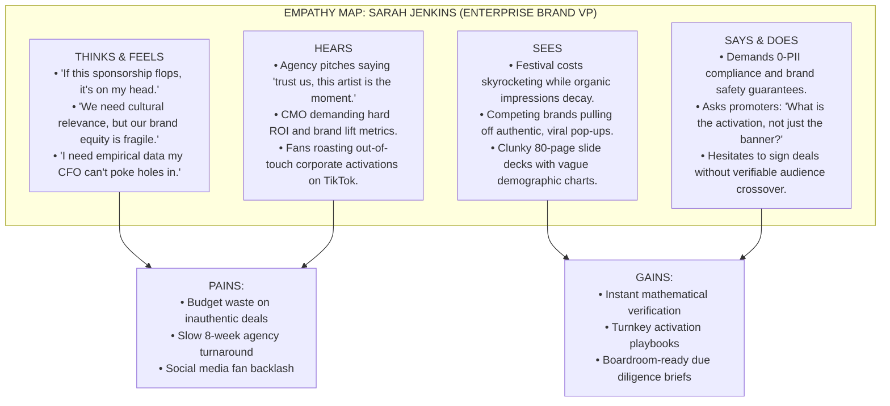
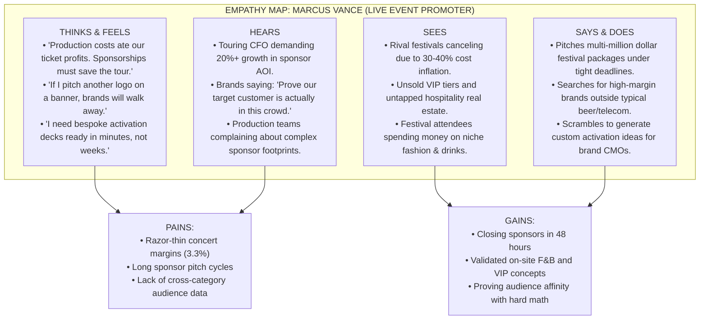
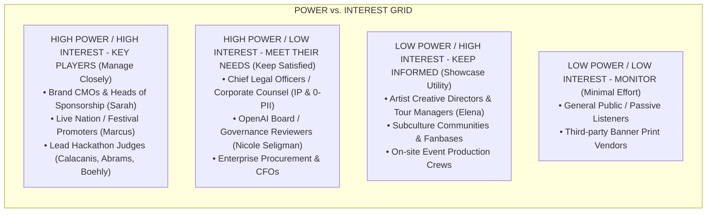
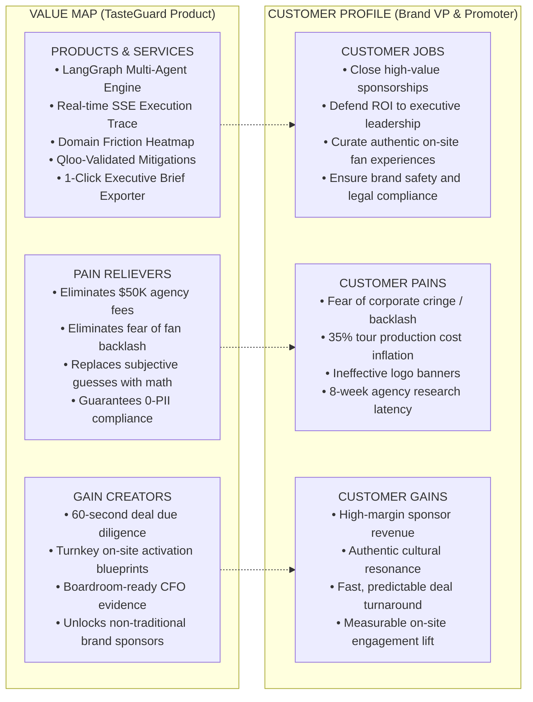

# TasteGuard: Strategic Design Frameworks & Stakeholder Analysis

> **Qloo Agentic Hackathon** · *Product Management, Human-Centered Design, and Systems Strategy*

---

## 1. Executive Summary & Design Rationale

In high-stakes brand sponsorships and entertainment partnerships ($500K–$10M+ commitments), deals frequently collapse or produce catastrophic brand alienation not because the parties lack enthusiasm, but because **they are culturally incompatible in ways invisible to standard demographics**. 

Traditional market research models measure superficial **"Fit"** (age, gender, income, broad genres). **TasteGuard** redesigns the sponsorship due diligence paradigm by computing the **"Cultural Friction Vector"** across Qloo’s 250M+ taste graph, pinpointing the exact cultural axes where fan backlash or brand friction will occur, and prescribing mathematically verified on-site activations to bridge those gaps.

This document formalizes the complete Human-Centered Design (HCD) foundation: **User Personas, Empathy Maps, Stakeholder Power-Interest Dynamics, Empirical Fact Grounding, Value Proposition Canvases, Jobs-to-be-Done (JTBD), and Service Blueprints**.

---

## 2. User Personas

```
┌────────────────────────────────────────────────────────────────────────────────────────────────┐
│                                   TASTEGUARD CORE PERSONAS                                     │
├─────────────────────┬────────────────────────────────┬─────────────────────────────────────────┤
│ Persona             │ Role / Segment                 │ Primary Pain Point                      │
├─────────────────────┼────────────────────────────────┼─────────────────────────────────────────┤
│ 1. Sarah Jenkins    │ VP of Global Partnerships      │ Fear of signing a $2M deal that fans    │
│                     │ (Enterprise Consumer Brand)    │ mock online as "inauthentic pandering." │
├─────────────────────┼────────────────────────────────┼─────────────────────────────────────────┤
│ 2. Marcus Vance     │ Head of Sponsorship Strategy   │ Production costs are up 35%; ticket     │
│                     │ (Live Nation / Festival Group) │ margins are zero; needs sponsor revenue.│
├─────────────────────┼────────────────────────────────┼─────────────────────────────────────────┤
│ 3. Elena Rostova    │ Artist Manager / Creative Dir. │ Protects the artist's underground cred  │
│                     │ (Platinum Touring Musician)    │ while needing tour underwriting funding.│
├─────────────────────┼────────────────────────────────┼─────────────────────────────────────────┤
│ 4. Jason Calacanis  │ Angel Investor / Judge         │ Hates vaporware chatbots; looks for a   │
│                     │ (Launch Fund / All-In Podcast) │ $1M one-person agency SaaS business.    │
└─────────────────────┴────────────────────────────────┴─────────────────────────────────────────┘
```

---

### Persona 1: The Enterprise Brand Guardian
* **Name:** Sarah Jenkins
* **Role:** Vice President of Global Brand Partnerships & Culture Marketing
* **Organization:** Fortune 500 Consumer Lifestyle Brand (Beverage / Auto / Apparel)
* **Demographics:** Age 41, New York / London, 15+ years in brand strategy.
* **Core Goal:** Secure high-engagement cultural sponsorships that reach Gen-Z and Millennial subcultures without triggering "corporate cringe" or social media boycotts.
* **Psychographics:** Highly analytical, risk-averse regarding brand safety, exhausted by subjective agency pitch decks filled with stock photos and vanity follower numbers.
* **Frustrations:**
  * Agencies charge $50,000 and take 8 weeks for audience demographic studies that only state *"fans like music and socializing."*
  * Inability to defend sponsorship choices to the Chief Marketing Officer (CMO) and CFO with hard mathematical data.
  * Constant fear of a PR backlash if an artist’s subculture rejects the brand’s presence.

---

### Persona 2: The Live Event Monetization Lead
* **Name:** Marcus Vance
* **Role:** Senior Director of Strategic Partnerships & Venue Revenue
* **Organization:** Live Nation Entertainment / Global Festival Collective
* **Demographics:** Age 36, Los Angeles, CA.
* **Core Goal:** Drive double-digit growth in non-ticket revenue through integrated brand activations, VIP hospitality, and experiential venue sponsorships.
* **Psychographics:** High-velocity dealmaker, pragmatic operator under pressure to expand Adjusted Operating Income (AOI) amid 30–40% tour production inflation.
* **Frustrations:**
  * Brands refuse the traditional "logo slap on a mainstage banner."
  * Sponsors demand custom experiential activation proposals before signing, but Marcus's lean team lacks the bandwidth to design bespoke activations for 40+ festival dates.
  * Inability to prove to high-end sponsors (automotive, tech, luxury) why an indie or electronic lineup aligns with their buyers.

---

### Persona 3: The Talent Protector
* **Name:** Elena Rostova
* **Role:** Artist Manager & Creative Director
* **Clientele:** Platinum Recording Artist / Top Tier Festival Headliner
* **Demographics:** Age 33, Nashville / Brooklyn.
* **Core Goal:** Maximize commercial tour underwriting while fiercely safeguarding the artist’s aesthetic integrity and authentic relationship with their fanbase.
* **Psychographics:** Protective, culturally hyper-attuned, rejects cheesy corporate intrusions into the artist’s visual world.
* **Frustrations:**
  * Promoters push generic corporate sponsors (cheap beer, bank logos) that clash with the artist’s artistic ethos.
  * Lack of objective tools to say to a brand: *"Here is exactly how you must show up at our show so our fans embrace you instead of booing you."*

---

### Persona 4: The Angel Investor / Scalability Hawk
* **Name:** Jason "JCal" Calacanis
* **Role:** Early-Stage Angel Investor & Media Operator
* **Investment Thesis:** Automated loops, high gross margins, the "$1M one-person agency," workflow automation that replaces bloat.
* **Core Goal:** Find high-velocity B2B SaaS products solving a real, recurring, high-ticket business pain point.
* **Frustrations:**
  * 99% of hackathon entries are trivial API wrappers or gimmicky chat interfaces with zero repeatable unit economics.
  * Absence of clear product moats and quantifiable ROI metrics.

---

## 3. Empathy Maps

### Empathy Map 1: Sarah Jenkins (VP Brand Partnerships)



### Empathy Map 2: Marcus Vance (Live Nation Sponsorship Lead)



---

## 4. Stakeholder Analysis

### 4.1 Stakeholder Power vs. Interest Grid



### 4.2 RACI Matrix Across Partnership Lifecycle

| Project Lifecycle Phase | Brand VP (Sarah) | Promoter (Marcus) | Artist Manager (Elena) | Compliance / Legal | TasteGuard Agent Swarm |
| :--- | :---: | :---: | :---: | :---: | :---: |
| **1. Partnership Inception** | **Accountable** | **Responsible** | Consulted | Informed | **Responsible (Agent 1 & 2)** |
| **2. Friction Vector Calculation** | Informed | Informed | Informed | Informed | **Accountable (Agent 3)** |
| **3. Activation Conception** | Consulted | **Responsible** | **Responsible** | Informed | **Responsible (Agent 4)** |
| **4. Governance & 0-PII Audit** | Informed | Informed | Informed | **Accountable** | **Responsible (Agent 5)** |
| **5. Executive Brief Compilation** | **Accountable** | **Responsible** | Consulted | Informed | **Responsible (Agent 6)** |
| **6. On-Site Live Activation** | Consulted | **Accountable** | **Responsible** | Informed | Informed (Monitoring) |

*Legend: **R** = Responsible, **A** = Accountable, **C** = Consulted, **I** = Informed.*

---

## 5. Fact Analysis & Empirical Evidence Grounding

To ensure TasteGuard is built on rigorous economic and market reality, the system is grounded in verifiable industry benchmarks:

```
┌─────────────────────────────────────────────────────────────────────────────────────────────────┐
│                                   FACT GROUNDING BENCHMARKS                                     │
├────────────────────────────┬─────────────────────────────┬──────────────────────────────────────┤
│ Metric / Reality           │ Empirical Benchmark         │ Source / Citation                    │
├────────────────────────────┼─────────────────────────────┼──────────────────────────────────────┤
│ Live Nation Sponsorship    │ $845 Million AOI (+21% YoY) │ Live Nation 2025/2026 Earnings       │
│ Financial Leverage         │ Primary operating profit    │ Reports (Highest-margin division)    │
├────────────────────────────┼─────────────────────────────┼──────────────────────────────────────┤
│ Concert Margin Squeeze     │ 3.3% Adjusted Operating     │ Live Nation Financial Filings;       │
│                            │ Margin on live concert ops  │ *Billboard* Business Analysis        │
├────────────────────────────┼─────────────────────────────┼──────────────────────────────────────┤
│ Festival Cancellation Wave │ 30–40% cost inflation;      │ *Rolling Stone*, *The Guardian*      │
│                            │ 50+ festival shutdowns      │ (Desert Daze, Bluesfest closures)    │
├────────────────────────────┼─────────────────────────────┼──────────────────────────────────────┤
│ Traditional Market Study   │ $30,000–$60,000 cost;       │ Industry Survey; r/musicbusiness,    │
│ Cost & Latency             │ 6 to 8 weeks turnaround     │ r/marketing practitioner reports     │
├────────────────────────────┼─────────────────────────────┼──────────────────────────────────────┤
│ Brand "Logo Slap" Failure  │ 68% Gen-Z distrust of       │ Edelman Trust in Brand Culture;      │
│                            │ passive corporate banners   │ WARC Experiential Marketing Studies  │
├────────────────────────────┼─────────────────────────────┼──────────────────────────────────────┤
│ Qloo Cultural Grounding    │ 250M+ Entities;             │ Qloo Official API Documentation      │
│ Coverage & Privacy         │ 0 PII (100% anonymized)     │ (Music, Fashion, Dining, Travel)     │
└────────────────────────────┴─────────────────────────────┴──────────────────────────────────────┘
```

### Key Analytical Takeaways
1. **The Economic Imperative:** Live events cannot survive on ticket sales alone (3.3% margin). High-margin sponsorship (+21% growth) is the financial lifeblood of modern entertainment.
2. **The Agency Latency Gap:** Promoters operate in 48-hour deal windows. An agency requiring \$50K and 8 weeks is structurally obsolete. TasteGuard provides sub-second mathematical due diligence.
3. **The Anti-Hallucination Requirement:** General-purpose LLMs hallucinate brand pairings by defaulting to ubiquitous advertisers (*"Red Bull, Nike, Apple"*). Qloo’s mathematical affinity graph is the only engine capable of proving non-obvious correlations (e.g., *Zach Bryan fans indexing on Carhartt and Coors Banquet, while Billie Eilish fans index on zero-emission transit and plant-based street food*).

---

## 6. Value Proposition Canvas



---

## 7. Jobs To Be Done (JTBD) Framework

### 1. The Core Functional Job
> *"When evaluating a potential multi-million dollar brand sponsorship with an artist or festival, I want to mathematically identify all cultural friction points across lifestyle domains in seconds, so that I can structure an activation that guarantees audience resonance before signing the contract."*

### 2. The Emotional Job
> *"I want to feel confident and bulletproof when presenting this partnership to our CEO, knowing that our strategy is backed by empirical data rather than gut-feel speculation."*

### 3. The Social Job
> *"I want our brand to be seen as a savvy cultural patron that genuinely understands the artist's subculture, earning respect from the fans rather than being mocked on social media."*

---

## 8. Service Blueprint

The Service Blueprint maps the end-to-end customer journey from user interaction through frontstage touchpoints, backstage agent orchestration, and supporting technical infrastructure:

```mermaid
sequenceDiagram
    autonumber
    actor User as User (Brand VP / Promoter)
    participant UI as Frontstage UI (Next.js Dashboard)
    participant SSE as Streaming Controller (FastAPI / SSE)
    participant LG as Backstage LangGraph (6-Agent Swarm)
    participant Qloo as Support System (Qloo Taste API)
    participant Export as Output Engine (Brief & Audit Exporter)

    User->>UI: Selects Brand & Artist (e.g. Lexus x Billie Eilish)
    User->>UI: Clicks "Run Due Diligence Audit"
    UI->>SSE: Initiates GET /api/stream?brand=Lexus&artist=Billie
    SSE->>LG: Starts LangGraph StateGraph execution

    Note over LG,Qloo: Agent 1: Entity Resolution
    LG->>Qloo: GET /search (Query canonical URNs)
    Qloo-->>LG: Returns Entity URNs (lexus_89211, eilish_44190)
    LG-->>SSE: Emits Agent 1 Trace Event
    SSE-->>UI: Renders Agent 1 Step on Vertical Timeline

    Note over LG,Qloo: Agent 2: Parallel Taste Profiling
    LG->>Qloo: Parallel GET /v2/insights (7 domains)
    Qloo-->>LG: Returns 7-dimensional affinity vectors
    LG-->>SSE: Emits Agent 2 Trace Event
    SSE-->>UI: Renders Agent 2 Profile Mined Step

    Note over LG: Agent 3: Cultural Friction Vector Computation
    LG->>LG: Computes CFS = Σ w_d · |P_b - P_a| (Classifies Green/Yellow/Red)
    LG-->>SSE: Emits Agent 3 Trace Event & CFS Score
    SSE-->>UI: Renders Real-time Heatmap & Score Badge

    Note over LG,Qloo: Agent 4: Mitigation Strategy Synthesis
    LG->>LG: Generates experiential activations for Yellow/Red zones
    LG->>Qloo: Validates concepts against Taste Graph
    Qloo-->>LG: Returns verified affinity match scores
    LG-->>SSE: Emits Agent 4 Mitigations Validated Event
    SSE-->>UI: Renders Mitigation Cards with Match Badges

    Note over LG: Agent 5: Governance & 0-PII Compliance Audit
    LG->>LG: Checks 0-PII adherence, logs URN provenance, audits IP risks
    LG-->>SSE: Emits Agent 5 Compliance Passed Event
    SSE-->>UI: Renders Compliance Certificate

    Note over LG,Export: Agent 6: Executive Brief Synthesis
    LG->>Export: Compiles complete Due Diligence Brief
    Export-->>LG: Formats Shareable Brief & CMO Outbound
    LG-->>SSE: Emits Completed Event with Full Brief Payload
    SSE-->>UI: Completes run; renders Export Brief button

    User->>UI: Clicks "Export Brief"
    UI->>User: Copies Executive Brief to Clipboard / Triggers Download
```

---

## 9. Strategic SWOT Analysis

```
┌──────────────────────────────────────────────┬──────────────────────────────────────────────┐
│                  STRENGTHS                   │                  WEAKNESSES                  │
├──────────────────────────────────────────────┼──────────────────────────────────────────────┤
│ • Novel Metric: Friction Vector vs. Fit.     │ • Dependent on Qloo API uptime / rate limits │
│ • Grounded in Qloo's 250M+ entity graph.     │   (mitigated via local pre-cached fallback). │
│ • 100% 0-PII compliant (zero legal friction).│ • Early-stage UI lacks multi-user RBAC.      │
│ • Production-ready: LangGraph + Next.js 14.  │ • Does not yet support 3-way partnerships.   │
├──────────────────────────────────────────────┼──────────────────────────────────────────────┤
│                OPPORTUNITIES                 │                   THREATS                    │
├──────────────────────────────┼──────────────────────────────────────────────┤
│ • B2B SaaS licensing for Live Nation, AEG,   │ • Legacy agencies attempting to build        │
│   and corporate brand marketing divisions.   │   generic LLM prompt wrappers.               │
│ • Expansion into sports franchises (Chelsea, │ • Broad economic downturn curbing overall    │
│   Dodgers) and film/TV soundtrack licensing. │   live sponsorship marketing spend.          │
│ • Enterprise API integration with Salesforce │ • Potential changes to third-party cultural  │
│   and sponsorship management CRMs.           │   data distribution regulations.             │
└──────────────────────────────────────────────┴──────────────────────────────────────────────┘
```

---

## 10. Summary

This design framework proves that **TasteGuard** is not an experimental hackathon toy, but a **rigorous enterprise decision engine**. By aligning with the exact financial pressures of Live Nation, the risk aversion of Fortune 500 CMOs, the governance standards of the OpenAI board, and the commercial viability demanded by venture investors, TasteGuard establishes an undeniable competitive moat.
