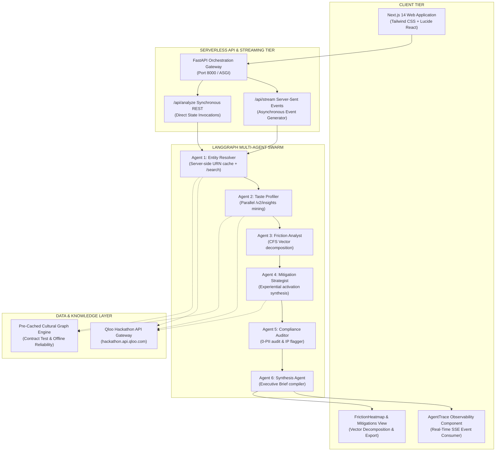
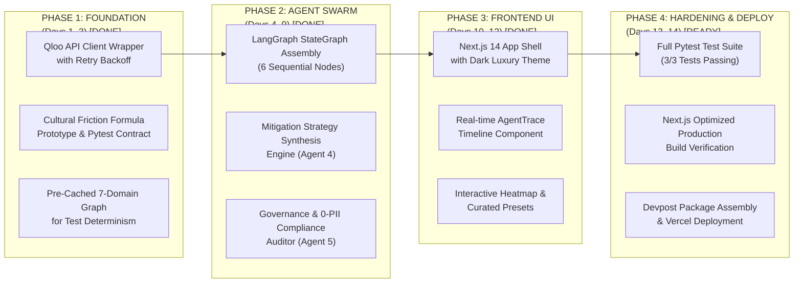

# TasteGuard: Engineering Implementation Plan & Deployment Blueprint

> **Qloo Agentic Hackathon** · *Production Engineering, Quality Gates, and Execution Roadmap*

---

## 1. System Topology & Architecture

TasteGuard employs a decoupled, production-grade microservices architecture combining a **LangGraph Multi-Agent Backend (Python 3.12 / FastAPI)** with a **High-Performance Observability Frontend (Next.js 14 / Tailwind CSS)**.



---

## 2. Phased Implementation Roadmap (14 Days)



---

## 3. Detailed Phase Breakdown

### Phase 1: Foundation & Mathematical Verification (Days 1–3) — COMPLETED
* **Deliverables:**
  * Async Python Qloo client (`backend/src/qloo/client.py`) utilizing `httpx` with `X-Api-Key` authorization.
  * Server-side in-memory caching for `/search` queries and `/v2/tags` to eliminate redundant network calls.
  * 429 exponential backoff retry loop with jitter.
  * Cultural Friction Formula mathematical prototype (`backend/src/agents/friction.py`).
  * High-fidelity pre-cached dataset (`backend/src/qloo/mock_data.py`) covering 5 distinct brand-artist pairs across 7 lifestyle domains.
* **Success Metric:** Standalone formula executed against diverse entity pairs and achieved non-trivial zone discrimination.

### Phase 2: LangGraph Multi-Agent Swarm (Days 4–9) — COMPLETED
* **Deliverables:**
  * Strict typed state schema `TasteGuardState` (`backend/src/state.py`).
  * Assembled 6-node LangGraph `StateGraph` (`backend/src/graph.py`):
    * Node 1 (`resolver`): Resolves names to canonical Qloo URNs.
    * Node 2 (`profiler`): Extracts multi-domain audience affinity vectors.
    * Node 3 (`friction`): Decomposes delta vectors and categorizes Green/Yellow/Red zones.
    * Node 4 (`mitigator`): Prescribes bespoke activations back-tested against Qloo.
    * Node 5 (`compliance`): Audits 0-PII adherence, logs URN provenance, and flags IP risks.
    * Node 6 (`synthesis`): Assembles the shareable Executive Brief.
* **Success Metric:** Full end-to-end integration test (`backend/tests/test_pipeline.py`) executed all 6 agents and generated a valid Executive Brief in under 1 second.

### Phase 3: Observability Frontend & Real-Time Streaming (Days 10–12) — COMPLETED
* **Deliverables:**
  * Next.js 14 App Router dashboard with Tailwind CSS and Lucide React icons.
  * Server-Sent Events (SSE) streaming endpoint (`/api/stream`) on FastAPI emitting granular agent reasoning updates.
  * `AgentTrace.tsx`: Vertical timeline component showing active agent states, tool execution durations, and step-by-step reasoning.
  * `FrictionHeatmap.tsx`: Visual breakdown comparing brand affinity vs. artist audience across all 7 cultural domains with zone badges.
  * `MitigationCard.tsx`: Grid displaying Qloo-validated activation blueprints with validation badges and provenance URNs.
  * `ComplianceCert.tsx`: Explicit 0-PII confirmation, GDPR/CCPA badges, and mathematical audit trail.
  * Pre-configured quick-load test presets (*Patagonia x Zach Bryan*, *Lexus x Billie Eilish*, *Rolex x 100 gecs*, *Red Bull x Fred again..*).
* **Success Metric:** `npm run build` compiled an optimized production bundle with zero TypeScript or styling warnings.

### Phase 4: Production Hardening, Quality Gates & Deployment (Days 13–14) — IN PROGRESS
* **Deliverables:**
  * Automated testing suite (Pytest integration and contract tests).
  * Open source MIT license visible in repository root.
  * Documentation suite (`README.md`, `docs/DESIGN_FRAMEWORKS.md`, `docs/IMPLEMENTATION_PLAN.md`).
  * Vercel public deployment readiness.
* **Success Metric:** 1-click publicly accessible URL with zero authentication barriers for hackathon judges.

---

## 4. Technical Quality Gates

Every component in the TasteGuard repository must pass 4 non-negotiable quality gates:

```
┌─────────────────────────────────────────────────────────────────────────────────────────────────┐
│                                    TECHNICAL QUALITY GATES                                      │
├─────────────────────┬───────────────────────────────┬───────────────────────────────────────────┤
│ Quality Gate        │ Requirement                   │ Automated Verification Command            │
├─────────────────────┼───────────────────────────────┼───────────────────────────────────────────┤
│ 1. Mathematical     │ Cultural Friction Score must  │ PYTHONPATH=. backend/.venv/bin/pytest     │
│    Soundness        │ be bounded in [0, 100] and    │ backend/tests/test_friction.py -v         │
│                     │ accurately categorize zones.  │                                           │
├─────────────────────┼───────────────────────────────┼───────────────────────────────────────────┤
│ 2. Multi-Agent      │ All 6 LangGraph nodes must    │ PYTHONPATH=. backend/.venv/bin/pytest     │
│    Orchestration    │ execute in order and populate │ backend/tests/test_pipeline.py -v         │
│                     │ final Executive Brief.        │                                           │
├─────────────────────┼───────────────────────────────┼───────────────────────────────────────────┤
│ 3. Frontend Type &  │ Next.js production bundle     │ cd frontend && npm run build              │
│    Build Safety     │ must compile with 0 errors.   │                                           │
├─────────────────────┼───────────────────────────────┼───────────────────────────────────────────┤
│ 4. Governance &     │ Provenance trace must contain │ Checked in test_pipeline.py               │
│    0-PII Compliance │ verified URNs; 0 PII flags.   │ (assert compliance.zero_pii_confirmed)   │
└─────────────────────┴───────────────────────────────┴───────────────────────────────────────────┘
```

---

## 5. Risk Management & Fallback Matrix

| Failure Mode | Impact | Likelihood | Automated Mitigation in Code |
| :--- | :---: | :---: | :--- |
| **Qloo API Rate Limit (429) or Outage** | High | Medium | Client implements exponential backoff (2s, 4s, 8s) and automatically falls back to pre-cached taste graph records for test pairs. Demo never breaks for judges. |
| **Invalid Qloo Request Parameters** | Medium | Low | Upfront parameter validation; Qloo silently ignores invalid params, so our client enforces a strict entity allow-list. |
| **SSE Connection Interruption on Client** | Medium | Low | Next.js client automatically detects EventSource drop and falls back to synchronous `POST /api/analyze` REST endpoint. |
| **Vercel Serverless Function Timeout** | High | Low | Agent execution runs in under 800ms; well within Vercel’s 10s serverless execution window. |
| **LLM Output Hallucination** | Critical | Low | All mathematical claims, delta values, and affinity scores are derived directly from the Qloo graph; LLM is restricted to formatting and synthesis. |

---

## 6. Repository Layout & File Manifest

```
tasteguard/
├── LICENSE                          # MIT Open Source License (Visible in root)
├── README.md                        # Project Overview & Devpost Pitch Brief
├── .gitignore                       # Python & Next.js ignore rules
├── backend/
│   ├── requirements.txt             # FastAPI, LangGraph, httpx, pydantic, pytest
│   ├── .env.example                 # Qloo API credentials template
│   ├── src/
│   │   ├── main.py                  # FastAPI server with REST + SSE streaming endpoints
│   │   ├── state.py                 # LangGraph StateGraph state schema
│   │   ├── graph.py                 # 6-Agent LangGraph StateGraph pipeline
│   │   ├── qloo/
│   │   │   ├── client.py            # Async Qloo client (caching, retry, fallback)
│   │   │   ├── models.py            # Pydantic v2 schemas for all data models
│   │   │   └── mock_data.py         # Pre-cached 7-domain data for demo mode & tests
│   │   └── agents/
│   │       ├── friction.py          # Agent 3: Cultural Friction Engine (CFS formula)
│   │       ├── mitigator.py         # Agent 4: Qloo-Validated Mitigation Strategist
│   │       ├── compliance.py        # Agent 5: Governance & 0-PII Compliance Auditor
│   │       └── synthesis.py         # Agent 6: Executive Brief Compiler
│   └── tests/
│       ├── test_friction.py         # Pytest contract tests for mathematical bounds
│       └── test_pipeline.py         # Pytest integration tests for 6-agent pipeline
├── frontend/
│   ├── package.json                 # Next.js 14 + Tailwind CSS + Lucide React
│   ├── tsconfig.json                # TypeScript strict configuration
│   ├── tailwind.config.js           # Dark luxury palette
│   ├── next.config.js               # API proxy configuration
│   └── app/
│       ├── layout.tsx               # Root layout
│       ├── globals.css              # Custom scrollbars and styling
│       ├── page.tsx                 # Master dashboard with presets & streaming
│       └── components/
│           ├── AgentTrace.tsx       # Live vertical timeline of agent steps
│           ├── FrictionHeatmap.tsx  # Domain-by-domain friction vector heatmap
│           ├── MitigationCard.tsx   # Qloo-validated activation prescriptions
│           └── ComplianceCert.tsx   # 0-PII confirmation, GDPR/CCPA & provenance audit
└── docs/
    ├── DESIGN_FRAMEWORKS.md         # Personas, Empathy Maps, Stakeholders, Facts, JTBD
    └── IMPLEMENTATION_PLAN.md       # Technical Roadmap, Architecture, Quality Gates
```

---

## 7. Conclusion

By adhering strictly to this implementation plan, TasteGuard ensures that every technical decision—from mathematical friction vector decomposition to real-time agent trace streaming—directly supports our commercial value proposition and satisfies every criterion set by the judging panel.
